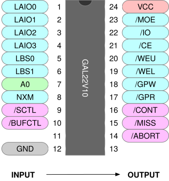
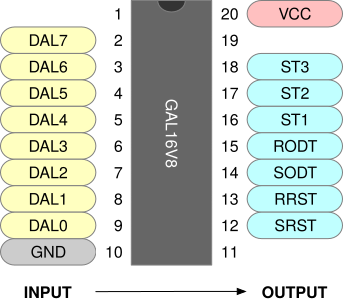
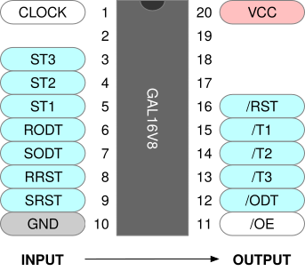

+++
date = '2026-09-18T17:54:39-05:00'
draft = true
title = 'PDP-11/Hack'
+++

My PDP-11/Hack is loosely based on this [DCJ11 Single Board Computer](https://www.5volts.ch/pages/dcj11sbc/) design. I deviate from the design in a few places, but I definitely would have had a much harder time figuring this all out on my own. So I thank the author for their generosity in sharing so much knowledge.

My goal here is to spell out my specific implementation in sufficient detail to allow future me to pick it back up and continue hacking. It's built on a huge perfboard with color-coded and labeled wires so it's easier to see where everything goes.

If you're reading along you should definitely have a copy of the **DCJ11 Microprocessor Users Guide** which you can find at [DEC Manuals](https://wfjm.github.io/home/w11/info/manuals.html) and elsewhere.

### Background

### High-Level Design


### Control and Address Latching

 indicates the start of an instruction cycle. We use it to clock the following values into [74HCT576](https://www.ti.com/product/SN74HCT574) latches.

| CPU Signal  | Latched Signal | Description |
| :---- | :-- | :-- |
| …  |  …  | Address |
| …  |  …  | Address I/O (Cycle Type)|
| …  |  …  | Bank Select |
| ∨  ∨   ∨   |  | Non-Existing Memory|

### Control Decoder

From the latched signals we derive the following control signals via a GAL22V10. These are valid for the entire instruction cycyle.

| Signal  | Destination | Description |
| :--- | :--- | :-- |
|  | CPU      | Bus abort, generated when addressing non-existing memory. |
|   | CPU      | Cache miss, asserted only for non-existing memory. |
|   | CPU      | Continue. Delay this signal when we're writing to the UARTs. |
|      | GPIO     | GPIO read. Assert startup word onto data bus. |
|       | GPIO     | GPIO write. Strobe GPIO decoder lines into LED indicator driver. |
|      | RAM/UART | Write-enable low. Move lower-order data from bus into RAM/UART. |
|      | RAM/UART | Write-enable upper. Move high-order data from bus into RAM/UART. |
|      | RAM/UART | Read enable. Move data from RAM/UART onto bus. |
|       | RAM      | RAM chip enable. Select RAM as read/write source. |
|       | UART     | UART chip enable. Select UART as read/write source. |

TODO:
  - rename `/CE` to `/RCE`
  - rename `/IO` to `/UCE`
  - rename `/MOE` to `/OE`.

Pinout and source.



```pld
GAL22V10
CTLDECODE

LAIO0 LAIO1  LAIO2 LAIO3 LBS0 LBS1 A0  NXM /SCTL /BUFCTL NC    GND
NC    /ABORT /MISS /CONT /GPR GPW  /WEL /WEU /CE /IO   /MOE   VCC

; Loosely based on https://www.5volts.ch/pages/dcj11sbc/040-dcj11-gal-decoder/

MOE          =  LAIO3 *  LAIO2 * /LAIO1 * /LAIO0          *  BUFCTL
             +  LAIO3 * /LAIO2                            *  BUFCTL;
          
CE            = /LBS1  * /LBS0  * /NXM;

IO            =  LBS1  * /LBS0;

WEL           = /LAIO3 * /LAIO2 * /LAIO1                   * /BUFCTL *  SCTL
              + /LAIO3 * /LAIO2 *  LAIO1          * /A0    * /BUFCTL *  SCTL;

WEU           = /LAIO3 * /LAIO2 * /LAIO1                   * /BUFCTL *  SCTL
              + /LAIO3 * /LAIO2 *  LAIO1          *  A0    * /BUFCTL *  SCTL;

GPR        =  LAIO3 *  LAIO2 *  LAIO1 * /LAIO0          *  BUFCTL;

GPW        =  /LAIO3 *  LAIO2 * /LAIO1 * LAIO0          *  /BUFCTL * SCTL;

; This can't be right .. CE relies on /NXM

ABORT      = SCTL * CE * NXM

; Assert /MISS only for non-existant RAM, this will shorten the
; memory read cycles to 4 clock cycles and make the DCJ11 think
; that these are cache hits. You need to install RAM with an 
; access time of 70ns or less.

; this is really just /CE isn't it?

MISS          = /LBS1 * /LBS0 *  NXM; 

;	Modify /CONT to stretch the CPU cycles for writes to external
;	IO registers so that the write impulse for the DC319 or CDP6402
;	is increased to match the requiremenets even for clock rates 
;	above 10MHz. By delaying CONT with SCTL for writes to external
;	IO registers the write pulse will be increased from 1 to 3 
;	clock cycles. 
;
;	For memory access we also have to assert CONT as read-modify-write
;	memory cycles use a stretched read cycle.
 
CONT          = /LBS1 * /LBS0 * /NXM;
              + /LBS1 * /LBS0 *  NXM *  SCTL
              + /LBS1 *  LBS0
              +  LBS1 * /LBS0        *  SCTL
              +  LBS1 *  LBS0;

DESCRIPTION
```

### GPIO Write Decoder

GPIO write cycles emit diagnostic information during boot and during entry/exit from ODT. We want to capture this information
and display it on LEDs. This could probably be done with a single GAL but I split out the decode phase in order to simplify
the LED driver. This is pure combinational logic and is decoded continuously.

| Signal | Description |
| :--- | :--- |
|  | CPU requests that peripherals enter reset. The UART is the only peripheral at this point. |
|  | CPU requests that peripherals exit reset. `SRST` and `RRST` are combined into a single `/RST` signal by the GPIO latch. |
|  | CPU has entered ODT. |
|  | CPU has exited ODT. |
|   | Startup test 1 has passed. |
|   | Startup test 2 has passed. |
|   | Startup test 3 has passed. |



```pld
GAL16V8
GPIODEC

NC  DAL7 DAL6 DAL5 DAL4 DAL3 DAL2 DAL1 DAL0 GND
NC  SRST RRST SODT RODT ST1  ST2  ST3  NC   VCC

SRST =  /DAL7 *  /DAL6 *  /DAL5 *  /DAL4 *   DAL3 *   DAL2 *  /DAL1 *  /DAL0 ; 014 Octal - Enter Reset
RRST =   DAL7 *  /DAL6 *  /DAL5 *  /DAL4 *   DAL3 *   DAL2 *  /DAL1 *  /DAL0 ; 214 Octal - Exit Reset
SODT =   DAL7 *  /DAL6 *  /DAL5 *   DAL4 *   DAL3 *   DAL2 *  /DAL1 *  /DAL0 ; 234 Octal - Enter ODT
RODT =  /DAL7 *  /DAL6 *  /DAL5 *   DAL4 *   DAL3 *   DAL2 *  /DAL1 *  /DAL0 ; 034 Octal - Exit ODT
ST1  =   DAL7 *  /DAL6 *  /DAL5 *   DAL4 *  /DAL3 *  /DAL2 *  /DAL1 *  /DAL0 ; 220 Octal - Test 1 Passed
ST2  =   DAL7 *  /DAL6 *  /DAL5 *   DAL4 *  /DAL3 *   DAL2 *  /DAL1 *  /DAL0 ; 224 Octal - Test 2 Passed
ST3  =   DAL7 *  /DAL6 *  /DAL5 *   DAL4 *   DAL3 *  /DAL2 *  /DAL1 *  /DAL0 ; 230 Octal - Test 3 Passed

DESCRIPTION
This decodes the GPIO write codes we care about.
```


### GPIO Latch

The GPIO latch is clocked by  (general-purpose write) from the control decoder. The ODT and test 
outputs drive status LEDs. The  output drives peripheral reset, which is just the UARTs
initially.



```
GAL16V8
GPIODEC

Clock  NC   ST3 ST2 ST1 RODT SODT RRST SRST GND
/OE    /ODT /T3 /T2 /T1 /RST NC   NC   NC   VCC

RST.R = SRST 
      + RST * /RRST

ODT.R = /SRST * /RST * SODT
      + /SRST * /RST * ODT * /RODT

T1.R = /SRST * /RST * ST1
     + /SRST * /RST * T1

T2.R = /SRST * /RST * ST2
     + /SRST * /RST * T2

T3.R = /SRST * /RST * ST3
     + /SRST * /RST * T3

DESCRIPTION
This decodes the GPIO signals we care about.
```